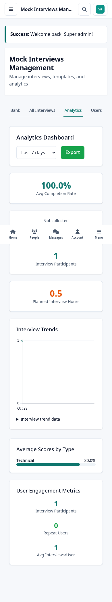
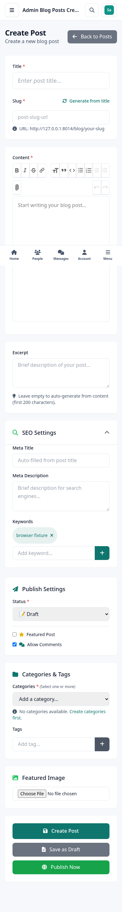

# Redesign release continuation

23 October 2026. This supersedes the test-failure and dependency counts in the initial implementation report.

## Repairs delivered

Expanded browser acceptance found and repaired narrow blog/resume editor layouts, an unbounded interview navigation bar and analytics header, an Alpine scope error in system-status management, and undefined affiliate eligibility links. Ineligible learners now reach the existing support workspace without a server error or an invented self-service instructor route.

The interview workspaces now resolve the existing Mentorship models. Administration checks the existing staff roles on every Livewire request. The learner dashboard reads the saved résumé completion accessor correctly, including after a learner creates a résumé. Six regression tests cover these failures, private learner records, interview ownership, revoked staff access and recorded analytics.

Interview analytics previously generated random scores/completion rates, assumed repeat users and duration, and displayed a hardcoded satisfaction score. It now aggregates actual completed scores, completion counts and repeat participants; duration is labelled as planned hours from recorded estimates. Satisfaction says “Not collected”; unscored types/users say “Not scored.” The existing Chart.js entry owns the trend lifecycle, handles date-filter remounts and theme updates, disables animation and supplies a bounded table alternative. No marks or learner results are written by reporting.

Shared Trix styling uses existing semantic tokens. Toolbar groups wrap, controls remain labelled and narrow form columns can shrink. Résumé export dismisses on Escape and returns focus. The existing printable résumé template is preserved.

Final compiler checks also found Blade directives embedded inside two mentorship dialog labels. Those dialogs now reference their visible titles with aria-labelledby. Isolated acceptance caught incomplete generated Composer maps; they were regenerated after dependency copying completed and verified with the branch suite. These intermediate failures were corrected before final packaging.

## Validation

- **Isolated branch suite: 262 passed, 1,347 assertions.** It excludes the user's unfinished course-content system. A dedicated `_test` database was used.
- **Six new workspace regressions: 6 passed, 27 assertions**, including real-record analytics assertions. The final complete working-tree run passes **275 tests/1,426 assertions**, including the in-progress course-content feature and its corrected HTTP fixture.
- **306 deduplicated browser checks across 112 routes/public URLs.** Final recorded states contain no unresolved horizontal overflow, uncaught JavaScript errors or unexpected server failures. The two 403 responses are expected authorization boundaries. Seven role shells retain 390/768/1024/1440px acceptance; 45 additional workspace routes were inspected at all four widths. Twenty affected-page viewport checks and the updated interactions were repeated against the isolated release source/assets.
- Interview administration: all five tabs, populated trend chart, date filter and recorded data; system status: all three tabs; blog: SEO controls/editor; résumé: five sections, preview, Export Escape/focus return, and return to the learner dashboard. Existing profile/drawer checks also pass with Livewire 3.8.11.
- **387 compiled Blade PHP files pass syntax checks.** The production working-tree and isolated builds, Blade cache, changed PHP checks, dependency platform checks and whitespace checks pass. The new workspace test and 592 changed dependency PHP files passed syntax checks.

This is recorded-state acceptance. Upload/editor edge cases, every parameterized page or conditional state, live provider/gateway delivery and complete assistive-technology/contrast certification remain separate integration acceptance. Browser screenshots use explicit test fixtures, not real learner outcomes. Backend job-search requests were not provider-success acceptance; missing/invalid integration responses remain limits.

The original bootkode_test schema had an inconsistent migration ledger and missing roles. No destructive repair was attempted there. Browser acceptance used the separately migrated bootkode_redesign_ui_test database; final suites used bootkode_dashboard_continuation_test. The working application database was not migrated or seeded.

## Dependency and delivery limits

Compatible Composer maintenance reduces advisories from 62/19 packages to **5/2 packages**, retaining Laravel 11, Livewire 3, Tailwind 3 and the declared PHP requirement. **8 npm vulnerabilities remain** in the build dependency graph. No forced major upgrades, audit suppression or new package was introduced. See [dependency maintenance](dependency-maintenance.md) and its audit evidence for exact versions, upstream limits and the isolated-install DNS failure.

The original content import/generation work, routes, configuration, documentation and authoring CSS remain uncommitted user work. Its revision test received a local fresh-HTTP-factory fixture correction; its original assertions remain intact. Release assets and Composer classmaps come from isolated committed application source.

Local delivery uses Conventional Commits on feat/bootkode-dashboard-redesign. The final ordinary push failed: `fatal: could not read Username for 'https://github.com': terminal prompts disabled`. All changes remain on the local feature branch; verification.md records the attempt. No pull request, deployment or external provider acceptance is implied.

