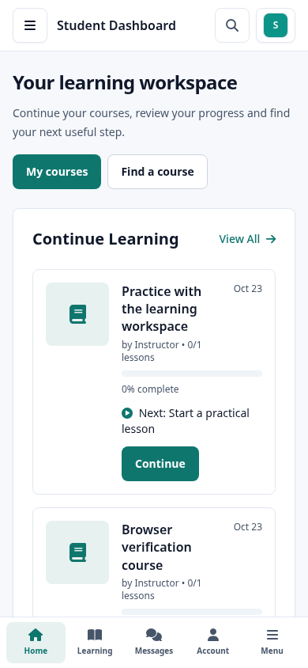
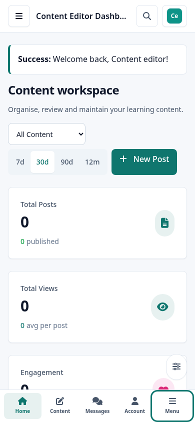
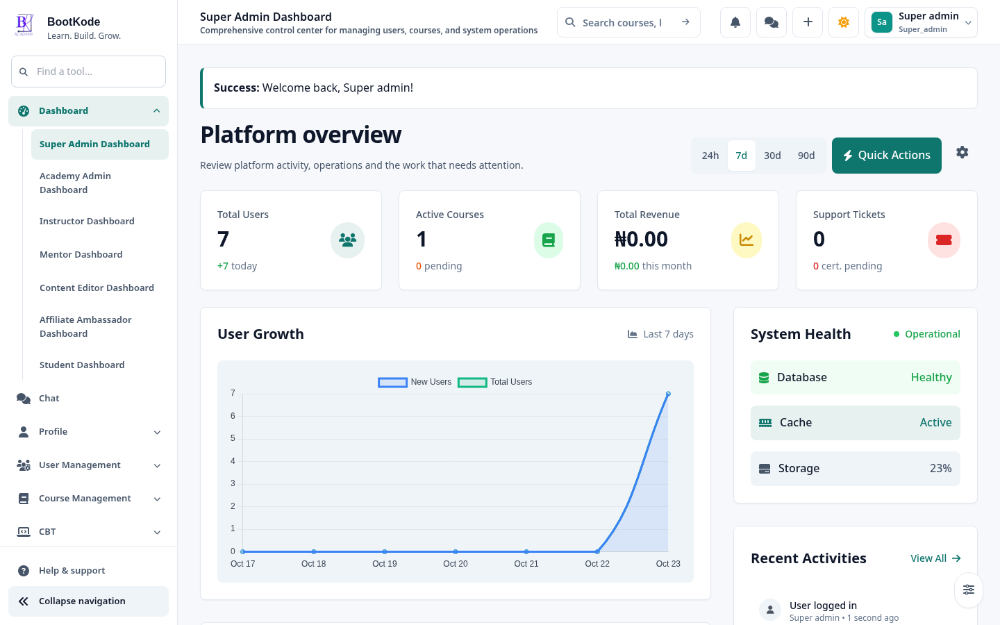

# Authenticated application redesign report

23 October 2026 · `feat/bootkode-dashboard-redesign`

Continuation acceptance supersedes the original blockers below: **275 working-tree tests pass; 262 branch-only tests pass; 306 browser checks cover 112 routes**. Composer findings are now 5 entries across 2 packages. See [continuation report](continuation-report.md) and [dependency maintenance](dependency-maintenance.md).

## Result and original problems

The authenticated application now shares a consistent responsive workspace and the existing navy/teal, Manrope/Sora design system. The audit found competing palettes/forced CSS overrides, inconsistent panel/header/form patterns, oversized decoration, duplicated mobile navigation, unnamed controls, inaccessible dialog wrappers and wide mobile layouts. Direct access testing also exposed an unguarded user directory.

The exact router inventory contains 286 routes: 223 require Authenticate, including 208 GET endpoints. Guest middleware is excluded. [Route inventory](route-inventory.md) lists each contract and middleware; [page checklist](page-checklist.md) records 116 directly resolved views, dependencies, migration status and individual browser coverage.

## Delivered interfaces

223 Livewire templates were refined across the seven role dashboards and these existing modules:

- Learner journey, catalogue, enrolled courses, lesson player, saved/offline resources, assessments and learning analytics.
- Instructor course creation, editing, builder, structured assessment authoring, review queue, course reviews, approval and quality workspaces.
- Certificates, requests, templates and analytics; existing credential/PDF rendering stays separate.
- Wallet, transactions, billing, checkout, earnings, withdrawals, financial configuration, payments, revenue and commercial readiness.
- Mentorship, sessions, code reviews, resources and mentor management.
- Rewards, achievements and leaderboard interfaces; unavailable games remain explicitly unavailable.
- Careers, jobs, portfolios, resume and interview workspaces.
- AI coach/mentor, community, messages, institutions, authenticated marketplace operations and affiliate tools.
- User/role management, profile/account settings, support, notifications, announcements, system operations, documentation, newsletter, blog and page publishing administration.

Existing page-header/panel/buttons/inputs/dropdown/modal primitives were extended. The new `ui.table` wraps 62 tables in labelled, keyboard-scrollable regions while preserving columns. Semantic tokens and scoped dashboard layout rules replace forced legacy palette remapping. Existing native filters and icon controls gained accessible names; core course-authoring fields expose linked labels/errors and invalid state. 84 existing dialog wrappers gained focus/Escape semantics; administrator quick actions reuse the shared modal. Decorative icons stay outside accessible button names without altering Blade expressions.

The shell uses a 256px desktop sidebar, persistent 80px rail, one full mobile/tablet drawer and four role-specific shortcuts plus Menu. Menu filtering expands matching groups, links announce current pages, mobile safe areas are accounted for, and floating widget settings sit above navigation. Local Font Awesome 6.5.2 assets retain their licence; the unused global Flatpickr request was removed. The established public fonts and Livewire-provided Alpine runtime remain unchanged.

The user directory now checks staff roles in component boot on every request, including exports and methods called through Livewire. Tests cover direct learner access and revoked administrative access. Existing verification notice component discovery/Blade nesting and the incomplete HTTP 400 template were repaired. The old inert profile Share control now states that a public account link is unavailable; no private account URL is presented as a shareable profile.

## Preserved contracts and exceptions

No financial, enrollment, assessment, certificate, provider or reward service was replaced. Prices, eligibility, ownership, payment settlement, historical records and private offline boundaries remain server controlled. No production migrations or browser fixtures were applied to the working database. Tests/browser data live only in dedicated `_test` databases.

Public marketing, public marketplace and published-page content/layout templates retain their existing implementation. Printable certificates/resumes and the focused CBT exam layout are deliberate exceptions to ordinary workspace geometry. Historical unrouted game prototypes remain intact. The user's uncommitted course-content import/generation system, Studio, routes, documentation and original generated CSS are preserved and excluded from feature commits. The All Courses Studio link remains an unstaged user change. Release assets were built from an isolated checkout of committed source.

Source review covers every inventoried route/view. Browser evidence does not certify every conditional state, populated table, upload/editor or external integration. These are explicit acceptance limits, not claims that unvisited states passed. The checklist identifies pages without separate browser acceptance. Provider/gateway delivery, mathematics CDN rendering and full assistive-technology/contrast certification need their own integration acceptance. Third-party network requests were blocked in the isolated browser run; locally hosted icons loaded successfully.

## Evidence and remaining blockers

- Full suite snapshot: **264 passed, 1 failed, 1,368 assertions**. The remaining failure is `CourseContentPipelineTest::test_changed_source_revision_requires_explicit_new_draft`: the pre-existing uncommitted importer records `skipped` where its test expects `conflict`.
- After correcting markup regressions found during implementation: **30 affected assessment/profile/navigation tests passed (200 assertions)**. The final navigation/verification run adds **5 passed (76 assertions)**, including unverified wallet rendering and the verified-profile redirect.
- **389 compiled Blade views passed PHP syntax checks**, with the repaired views checked again after the final notice changes. Changed PHP files pass syntax checks; production Vite build, Blade cache and whitespace checks pass.
- **108 deduplicated browser checks across 68 routes/public URLs**, including all seven roles at **390/768/1024/1440px**, and populated learner checks at **360/1366px**. The final checked states have no horizontal page overflow or uncaught page errors. Both observed 403 responses are expected access boundaries. Nine profile view tabs and five edit tabs retain navigation; drawer trapping/focus return, transaction export Escape, admin quick actions, form validation and dark mode were exercised. [Machine-readable checks](evidence/browser-checks.json).
- Dependency audit: **19 Composer packages have advisories; npm reports 8 vulnerabilities (5 high, 3 moderate)**. No dependencies were upgraded or advisories suppressed during styling. Resolve compatible security maintenance before production release.
- HTTPS push attempts fail with `fatal: could not read Username for 'https://github.com': No such device or address`. The remote remains `https://github.com/Dayoebe/bootkode.git`; no remote branch creation or push success is claimed. Local feature commits are retained. Authenticate the existing Git environment and run `git push -u origin feat/bootkode-dashboard-redesign`.

Implementation introduced a sidebar event-directive collision and later malformed Blade expressions during markup migration. Tests/compiled-PHP checks caught them; corrected reruns are recorded above. Mobile browser checks also found and resolved a navigation overlap, intrinsic table sizing and narrow header/list overflow. Those defects are not left as baseline failures.

## Review and next actions

The commits separate inventory, shell, workspace migration, access protection, scope preservation, responsive/accessibility repairs and isolated assets. The final chat response lists their hashes; `git log --oneline f21e1575..feat/bootkode-dashboard-redesign` reproduces the complete series, including this report's own documentation commit.

Before deployment: resolve the remaining dependency advisories, finish provider-specific acceptance where configured, and authenticate Git to push this branch. The importer fixture failure is resolved locally as recorded in the continuation report. A pull request/deployment was not created.

Screenshots below use controlled fixtures from the dedicated test database; they are visual evidence, not product claims or real learner outcomes.

